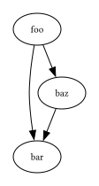
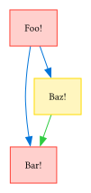
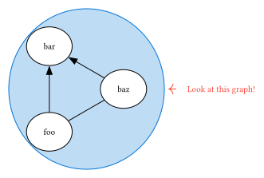

# autograph


A [Typst](https://typst.app/) package for drawing graphs with automatic layout, built on top of [fletcher](https://github.com/Jollywatt/typst-fletcher) and [diagraph-layout](https://github.com/felsenhower/diagraph-layout) (Note: Since autograph v0.1.1, we are using a forked version of diagraph-layout that contains multiple fixes. I will switch back to the upstream diagraph-layout if the fixes get merged).

## Usage Examples


```typ
#import "@preview/autograph:0.1.2": diagram, node, edge
#diagram(
  node(<foo>),
  node(<bar>),
  node(<baz>),
  edge(<foo>, <bar>),
  edge(<foo>, <baz>),
  edge(<baz>, <bar>),
)
```

autograph's syntax is somewhat of a hybrid between fletcher and dot ([Graphviz](https://graphviz.org/)).

In fact, it uses Graphviz's layout engine via [diagraph-layout](https://github.com/felsenhower/diagraph-layout) to determine the concrete node positions and edge paths and uses fletcher to render the layout.

The `autograph.diagram` function is a wrapper around `fletcher.diagram` that works as a drop-in replacement with some additional features.

For comparison's sake, here is same graph written with dot, rendered with [diagraph](https://github.com/Robotechnic/diagraph), a more low-level interface to Graphviz:



````typ
#import "@preview/diagraph:0.3.6": *
#raw-render(
  ```dot
  digraph {
    foo -> bar
    foo -> baz
    baz -> bar
  }
  ```
)
````

autograph also supports flexibly styling your graph with fletcher. The example below shows how you can customize the look for your nodes and edges. See the fletcher [manual](https://fletcher-package.github.io/manual/intro.html) to find out more about styling.



```typ
#import "@preview/autograph:0.1.2": diagram, node, edge
#diagram(
  node-shape: "rect",
  node-fill: red.lighten(75%),
  node-stroke: 1pt + red,
  edge-stroke: 1pt + blue,
  edge-corner-radius: 75pt,
  node(<foo>, [Foo!]),
  node(<bar>, [Bar!]),
  node(<baz>, [Baz!], stroke: yellow, fill: yellow.lighten(75%)),
  edge(<foo>, <bar>),
  edge(<foo>, <baz>),
  edge(<baz>, <bar>, stroke: green),
)
```

Since autograph's diagram works as a drop-in replacement for fletcher's diagram, you can also use fletcher nodes and edges and refer to the autograph nodes via their labels. We re-export `fletcher`, so you can use that to make sure that you're using the correct version.



```typ
#import "@preview/autograph:0.1.2" as autograph: diagram, fletcher
#diagram(
  engine: "circo",
  node-fill: white,
  {
    import autograph: node, edge
    (
      node(<foo>),
      node(<bar>),
      node(<baz>),
      edge(<foo>, <bar>),
      edge(<foo>, <baz>),
      edge(<baz>, <bar>),
    )
  },
  {
    import fletcher: node, edge
    (
      node(
        enclose: (<foo>, <bar>, <baz>),
        shape: "rect",
        stroke: 1pt + blue,
        inset: 0.5em,
        fill: blue.lighten(75%),
        outset: 0.5em,
        name: <group>,
      ),
      node(
        (rel: (6.5em, 0em), to: <group.east>),
        stroke: none,
        fill: none,
        inset: 0mm,
        outset: 0.5em,
        text(red)[Look at this graph!],
        name: <caption>,
      ),
      edge(
        <caption>, <group>, "->", stroke: red,
      ) ,       
    )
  }
)
```

## How It Works

autograph uses [diagraph-layout](https://github.com/Robotechnic/diagraph-layout) to layout the graph. Internally, diagraph-layout uses Graphviz.

To draw a graph with autograph, we perform the following steps:
1. For each node we want to draw, we need to acquire its exact dimensions it will have in the final diagram (this is crucial for step 2). To do so, we do the following for each node:
    - Create a dummy fletcher diagram containing a single fletcher node. This is necessary, because node dimensions are influenced by arguments like `node-inset`.
    - Measure the size of the diagram using [`measure`](https://typst.app/docs/reference/layout/measure/)
2. We acquire the layout using diagraph-layout's `layout-graph` function. Here, we pass the `width` and `height` of each node we measured before.
3. We make the following guarantees:
    - The order of all elements inside the diagram is exactly preserved. This includes both nodes *and* edges (both the autograph variants *and* their fletcher counterparts).
    - The first autograph node in the diagram will be positioned at `(0pt, 0pt)`.
   Since diagraph-layout makes no such guarantees, we reorder the nodes and shift all points.
4. We draw the elements as follows:
    - We draw nodes as fletcher nodes using the positions and measurements we acquired before.
    - We draw edges as fletcher edges via fletcher's new `custom` edge kind in combination with `cetz.draw.bezier` (Graphviz defines edges as Bézier paths).
    - We pass through all other elements (e.g. fletcher elements) unchanged.

## Changelog

### 0.1.3

- Implement strong ordering guarantees: The order of all elements inside a `diagram` is completely preserved, including fletcher elements.
- Re-export dependencies (`fletcher`, `diagraph-layout`, ...)
- Refactor:
  - Restructure source files
  - Add tests and linting (`tytanic`, `tinymist`, `typst-package-check`)
  - Add CI

### 0.1.2

- Use fletcher v0.6.0.
- Implement Bézier edges properly with fletcher's new features.
- Remove `bezier` argument from `diagram`.

### 0.1.1

- Use and bundle [forked diagraph-layout](https://github.com/felsenhower/typst-autograph) instead of [upstream version](https://github.com/Robotechnic/diagraph-layout).
- Maintain edge order by supplying edge names instead of the previous hack.

### 0.1.0

- Initial release.

## Limitations / Planned Features

- It would be nice to add a `graph` function in which we can optionally enclose our nodes and edges. This would allow us to have multiple graphs that are rendered independently from each other. The `graph` function should have an optional parameter `origin` that puts the root node to that location (instead of `(0pt, 0pt)`). This may also come in handy when we're only dealing with one graph.
- We're currently not supporting edge labels.
- We're currently not supporting undirected graphs.
- We're currently unable to set node, edge, and graph attributes. For example, it would be nice to set the drawing direction (`rankdir`) among other things. In some cases, attributes should be set automatically. For example, when we set `node-shape: rect` in the diagram, we should also pass `shape=box` to Graphviz to improve rendering in some edge cases.
- We're currently applying some default styles to the diagrams to get the ellipse-shaped nodes and arrow-shaped edges. It's not hard to turn those off but it might be convenient to turn all of them off with a single argument.
- Missing something? Create an [Issue](https://github.com/felsenhower/typst-autograph/issues/new)!
