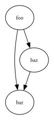
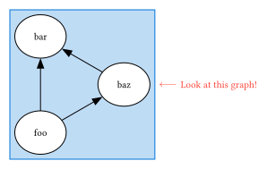
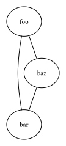
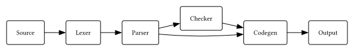
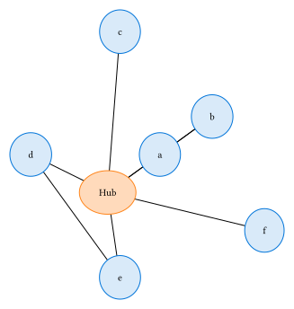
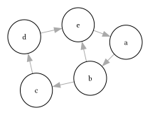
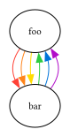
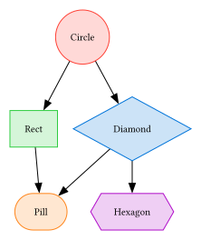
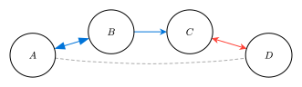

# autograph

A [Typst](https://typst.app/) package for drawing graphs with automatic layout, built on top of [fletcher](https://github.com/Jollywatt/typst-fletcher) and [Graphviz](https://graphviz.org/).

## Documentation

See the [manual](https://github.com/felsenhower/typst-autograph/blob/v0.1.3/docs/manual.pdf) for a guide on styling and mixing with fletcher, and a reference of all functions.

## Usage Examples



```typ
#import "@preview/autograph:0.1.3": diagram, node, edge
#diagram(
  node(<foo>),
  node(<bar>),
  node(<baz>),
  edge(<foo>, <bar>),
  edge(<foo>, <baz>),
  edge(<baz>, <bar>),
)
```

<table>
  <tr>
    <td align="center" width="33%">
      
      <br>
      <sub>A styled graph (<a href="examples/styling.typ">source</a>).</sub>
    </td>
    <td align="center" width="33%">
      
      <br>
      <sub>Mixing with Fletcher elements (<a href="examples/mix-fletcher.typ">source</a>).</sub>
    </td>
    <td align="center" width="33%">
      
      <br>
      <sub>An undirected graph (<a href="examples/undirected.typ">source</a>).</sub>
    </td>
  </tr>
  <tr>
    <td align="center" width="33%">
      
      <br>
      <sub>Left-to-right layout with <code>rankdir: ltr</code> (<a href="examples/ltr.typ">source</a>).</sub>
    </td>
    <td align="center" width="33%">
      
      <br>
      <sub>Radial layout with the <code>twopi</code> engine (<a href="examples/twopi.typ">source</a>).</sub>
    </td>
    <td align="center" width="33%">
      
      <br>
      <sub>Spring-model layout with the <code>neato</code> engine (<a href="examples/neato.typ">source</a>).</sub>
    </td>
  </tr>
  <tr>
    <td align="center" width="33%">
      
      <br>
      <sub>Multiple edges between the same nodes (<a href="examples/multi-edges.typ">source</a>).</sub>
    </td>
    <td align="center" width="33%">
      
      <br>
      <sub>Different node shapes (<a href="examples/shapes.typ">source</a>).</sub>
    </td>
    <td align="center" width="33%">
      
      <br>
      <sub>Bidirectional edges and custom marks (<a href="examples/marks.typ">source</a>).</sub>
    </td>
  </tr>
</table>


## Changelog

### Upcoming

- Decouple graph styles from diagram styles: You can now pass something like `graph-options: (node-shape: "rect")` and it will only apply to autograph nodes.
- Add a manual

### 0.1.3

- Implement strong ordering guarantees: The order of all elements inside a `diagram` is completely preserved, including fletcher elements.
- Re-export dependencies (`fletcher`, `diagraph-layout`, ...)
- Refactor:
  - Restructure source files
  - Add tests and linting (`tytanic`, `tinymist`, `typst-package-check`)
  - Add CI

### 0.1.2

- Use fletcher v0.6.0.
- Implement Bézier edges properly with fletcher's new features.
- Remove `bezier` argument from `diagram`.

### 0.1.1

- Use and bundle [forked diagraph-layout](https://github.com/felsenhower/typst-autograph) instead of [upstream version](https://github.com/Robotechnic/diagraph-layout).
- Maintain edge order by supplying edge names instead of the previous hack.

### 0.1.0

- Initial release.

## Limitations / Planned Features

- It would be nice to add a `graph` function in which we can optionally enclose our nodes and edges. This would allow us to have multiple graphs that are rendered independently from each other. The `graph` function should have an optional parameter `origin` that puts the root node to that location (instead of `(0pt, 0pt)`). This may also come in handy when we're only dealing with one graph.
- We're currently not supporting edge labels.
- Since fletcher v0.6.0, fletcher nodes can also directly be placed inside a `cetz.canvas`. Might be an option for us as well.
- Missing something? Create an [Issue](https://github.com/felsenhower/typst-autograph/issues/new)!
